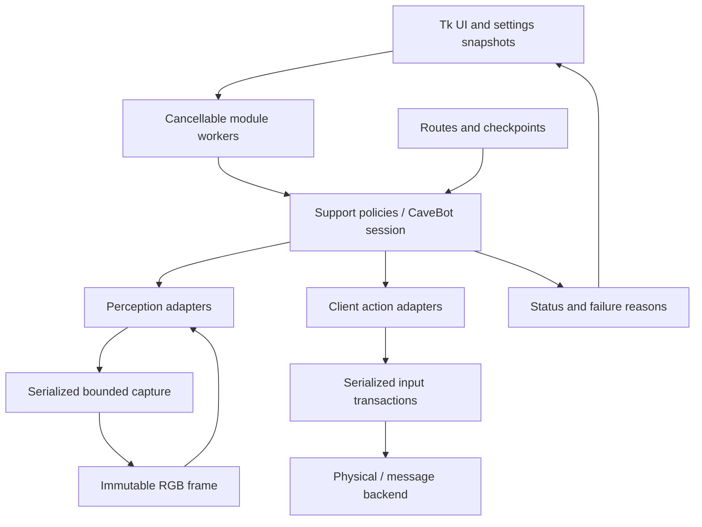

# TibiaAuto12

A Windows desktop automation project built around captured client images and client-local input. The reliability foundation separates capture, decisions, input, configuration, and Tk UI so higher-level features can be developed and tested offline.

**Validation boundary:** automated tests use synthetic images, fake input backends, simulated clocks, and saved configuration. They do not establish compatibility with a current Tibia client, prove detection accuracy on real hunts, or confirm that a client accepts window-message input. The bundled templates and bar geometry still need calibration against the intended client layout.

## Install and start

Use Windows and Python 3.10–3.12 for the desktop app. Linux can run the headless checks and tests; Linux desktop automation is unsupported.

```powershell
python -m venv .venv
.venv\Scripts\python -m pip install -r requirements.txt
.venv\Scripts\python -m tools.doctor --assets
.venv\Scripts\python start.py
```

`start.bat` prefers the repository's `.venv` and sets the working directory. Application asset and configuration paths also work independently of the current directory.

1. Select the input client window. Select the capture window separately when using an OBS projector.
2. A separate capture window must show the same client content at the same client-area size, without scaling, letterboxing, or cropping. Matching dimensions are a necessary check, not proof of matching content.
3. Create or load a calibration profile. Older profiles require the **Recalibrate existing profile** option once to bind their geometry to client dimensions. Failed detection preserves the previous profile. Resizing the client requires recalibration.
4. Open a module, review its settings, and start it explicitly. In physical-input mode the worker waits up to 30 seconds for you to focus the selected game window. Losing focus after activation fails closed; the app does not automatically steal focus.
5. Stop a module before changing its settings. Closing its window stops its worker. Closing the application cancels all managed workers.

A capture timeout or invalid window fails closed and surfaces a worker error. If a native capture call remains hung, subsequent requests are bounded; restart the app after resolving the client/window issue.

## Available behavior

| Area | Behavior on this branch |
|---|---|
| Auto Heal / Mana | One snapshot per scan, most urgent satisfied threshold, cooldown, unknown readings cause no action |
| Haste / Food | Condition-driven action with cooldown |
| Ring / Amulet | Explicit empty-slot evidence; optional independent life condition; hotkey or validated client-local drag |
| Timed spells | Monotonic deadlines, spacing, no catch-up burst |
| CaveBot | Walk routes, ordered target priorities, follow toggle, stand duration, bounded marker/arrival/combat waits, pause, optional bounded loot |
| Route editor | Validated save/load, legacy route import, separate resume checkpoint |

Rope/Shovel execution, depot/refill, fishing, reconnect/login, and other unfinished legacy modules are not supported by this foundation. The CaveBot UI does not promise unimplemented behaviors. Loot remains a debounced target-count-drop heuristic using the surrounding calibrated tiles; it is not corpse recognition. Set loot off when that behavior is inappropriate.

The health/mana reader retains the existing 100-pixel bar calibration and reports five-percent steps. A missing/unreadable fill is unknown, not zero. It does not infer death or reliably distinguish a truly empty bar from failed observation.

## Offline checks

```powershell
.venv\Scripts\python -m pip install -r requirements-dev.txt
.venv\Scripts\python -m pytest -q
.venv\Scripts\python -m ruff check .
.venv\Scripts\python -m tools.doctor --assets --route ratThais --json
.venv\Scripts\python -m tools.doctor --profile NewConfig.json
```

On Linux use `.venv/bin/python`. The doctor never captures a window or sends input. `--profile` checks saved geometry, not its correspondence with a live screen. `--route` checks the definition, referenced marker assets, and any resume checkpoint. Its exit code is nonzero on errors.

CI runs the offline suite and syntax/undefined-name checks on Windows and Linux with Python 3.10 and 3.12. GUI tests require a display and skip where one is unavailable.

## Architecture



| Contract | Location | Rule |
|---|---|---|
| Worker lifetime | `core/runtime.py`, `core/ThreadManager.py` | One active target per name; cancellation invalidates pending work; restart waits for the previous target to finish |
| Capture / matching | `core/perception.py`, `core/HookWindow.py` | Bounded native-call waiting; immutable frame; explicit errors; reusable frame scope; validated regions and cached templates |
| Input | `conf/Hotkeys.py`, `core/MoveMouse.py`, `core/SendToClient.py` | Client-local coordinates; validated endpoints; serialized sequences; release held buttons/modifiers in cleanup |
| Support decisions | `engine/support.py` | Pure threshold, cooldown, equipment, and timed-spell policies |
| CaveBot decisions | `engine/CaveBot/session.py` | Injected perception/actions/clock/token; iterative state transitions and bounded operations |
| Routes | `engine/CaveBot/routes.py` | Immutable definition, explicit action validation, independent fingerprinted checkpoint |
| Configuration | `conf/conf_manager.py`, `core/paths.py` | Anchored filenames; locked read-modify-write; atomic replacement; preserve existing settings |
| UI | `modules/support_ui.py`, `modules/CaveBot.py` | Tk calls on Tk thread; immutable settings passed to worker; status polled with `after` |

See [the engineering contract](docs/reliability-foundation.md) for extension rules, migration, and the remaining live-client acceptance checks.
