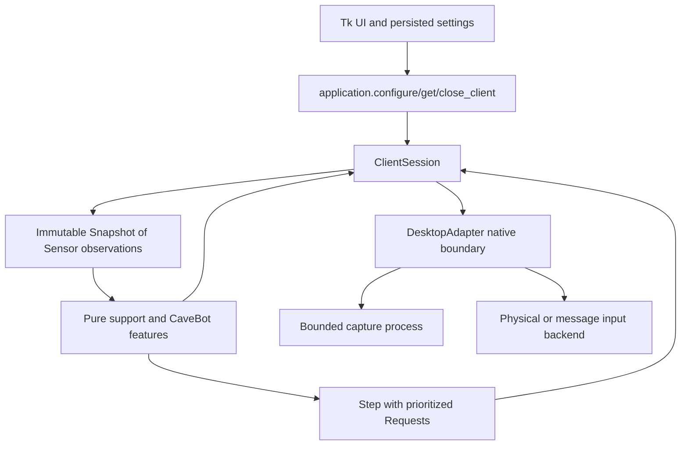

# TibiaAuto12

TibiaAuto12 is a Windows desktop automation project built around captured client images and client-local input. A shared client SDK separates feature decisions from Tk, capture, native input, scheduling, and persistence, so the decision layer can be exercised offline.

**Validation boundary:** the automated suite uses preserved screenshots, generated image perturbations, fake adapters, virtual clocks, and saved configuration. Passing it does not establish compatibility with a current Tibia client, prove detection accuracy during real play, or prove that a client accepts physical or window-message input. Templates, bar geometry, DPI, capture layout, and input behavior still require controlled validation on the intended installation.

## Install and start

The draft host integration includes **Local Tibia** and **Windows Sandbox** targets.
Before choosing a backend, run the separate [experimental desktop probe](docs/desktop-probe.md)
with `probe.bat`. It measures the actual capture and input paths without starting bot
modules or changing profiles.
The [live probe results](docs/desktop-probe-live-results.md) record accepted basic
host and Sandbox input, rejected alternatives, and remaining untested operations.
Local mode keeps the client/OBS integration. Sandbox mode selects a calibrated
guest game viewport in the host Sandbox window and uses foreground physical
input. Use **Configure Sandbox area**
in window selection, then calibrate and complete **Test client** for that target.
See [Windows Sandbox setup](docs/windows-sandbox.md) for the supported layout,
coordinate mapping and measured live results. Sandbox setup needs only one capture
and a viewport rectangle; paired focus samples are optional legacy probe data.

The default availability policy is **on error**. Input goes directly to its native
backend without a pre-action screenshot, focus/template check or dialog search.
When capture or input returns an error, the adapter inspects client availability
and adds diagnostics to the error result. The probe defaults to `error_only_physical`
and `direct_visible_region_gdi`; its older guarded backends remain explicit experiments.

Use Windows and Python 3.10–3.12 for the desktop app. Linux can run the headless checks and tests; Linux desktop automation is unsupported.

```powershell
python -m venv .venv
.venv\Scripts\python -m pip install -r requirements.txt
.venv\Scripts\python -m tools.doctor --assets
.venv\Scripts\python start.py
```

`start.bat` prefers the repository's `.venv` and sets the working directory. Application assets and configuration paths work independently of the current directory.

1. Select the input client window. Select the capture window separately when using an OBS projector.
2. A separate capture window must show the same content at the same client-area size, without scaling, letterboxing, or cropping. Equal dimensions are necessary, but do not prove that pixels and input coordinates align.
3. Create or load a calibration profile. Older profiles require **Recalibrate existing profile** once to bind their geometry to the configured capture dimensions. Failed calibration preserves the previous profile. Resizing the client requires recalibration.
4. Open a module, review its settings, and start it explicitly. Physical input uses the host keyboard and mouse; keep the intended game selected. Neither physical nor message input performs a client-availability preflight under the default policy.
5. Stop a feature before changing its settings. Closing a standalone feature window stops that feature before saving its settings. The Hunt workflow panel hides on close and preserves its draft and running workflow; use **Stop workflow** or **STOP ALL** to stop it. Closing the application closes the shared client session and its adapter.

Capture, invalid geometry, stale observations, and adapter errors appear in feature status. Availability is diagnosed after a reported capture or input error, without automatically replaying the action. A native OS call cannot always be interrupted after it has entered the operating system; capture and input retain bounded waits and cancellation.

## Available behavior

| Area | Implemented behavior |
|---|---|
| Auto Heal / Mana | One coherent observation per scheduler tick, most urgent satisfied threshold, cooldown, and no action from unknown or stale readings |
| Haste / Food | Status-driven hotkey request with cooldown |
| Ring / Amulet | Explicit empty-slot evidence, optional independent health condition, hotkey or validated client-local drag |
| Timed spells | Monotonic deadlines, configured spacing, and no catch-up burst |
| CaveBot | Walk routes, ordered target priorities, follow toggle, stand duration, bounded marker/arrival/combat waits, pause control, and optional bounded loot |
| Route editor | Validated save/load, legacy route import, stable waypoint IDs, and a separate fingerprinted resume checkpoint |
| Hunt workflow | Ordered outbound/return segments, observed supply thresholds, guarded deposit/sell/refill actions, bounded refill loops, and restart reconciliation |
| Visual inventory | Locally configured container/item templates and digit counts, explicit unknown/ambiguous results, and confirmed loot transfers |
| Adaptive resources | Semantic Skills-panel discovery for health, mana, soul and integer capacity; scaled recognition, guarded current-frame reads and background reacquisition |

CaveBot is now a nonblocking SDK feature. Navigation, combat, follow, and loot advance through short ticks and submit individual requests to the shared scheduler. This lets higher-priority support and healing requests run between CaveBot actions. It does not interrupt a native call that is already executing, and priority alone is not proof of a real-client safety guarantee.

The **Hunt workflow** window composes existing routes with visually guarded actions for one configured client layout. Its supply, container and item detectors require locally captured templates; no bundled detector is claimed to work with an untested client. See the [workflow setup guide](docs/hunt-workflow.md). Failed or ambiguous inventory actions require fresh evidence or an explicit operator reconciliation before progress continues.

For resource observations, **Detect resource panel from saved capture** locates the bundled
Skills labels, highlights the detected fields and shows offline values before you save. An
ambiguous result offers a panel chooser. At runtime, layout changes invalidate dependent
readings and queued workflow actions while a background worker reacquires the panel. Capture
and input alignment remain independently gated; this does not authorize scaled or cropped
captures for input. See [adaptive reading](docs/adaptive-reader.md) and the
[comparison benchmark](docs/resource-benchmark.md) for the tested evidence and limits.
Use the [session recorder and replay benchmark](docs/resource-sequences.md) for
full-frame timelines and the [collection protocol](docs/resource-benchmark-collection.md)
for native capture evidence. Acceptance uses unchanged real screenshots with
documented visual equivalence. The [latency benchmark](tools/benchmark_resource_latency.py)
measures full-frame discovery and every cached read separately.

The [expanded visual benchmark](docs/visual-detection-benchmark.md) includes
health/mana bars, battle-list names/counts/selection, automatic minimap location
and map markers, with a reviewable annotation overlay for the original images.

The standalone CaveBot retains its optional bounded target-count-drop loot heuristic over calibrated surrounding tiles; that legacy option is not corpse recognition. The new workflow disables that heuristic and offers a separate recognized-container transfer policy. Generic Rope/Shovel waypoint execution, fishing and reconnect/login remain unavailable. Travel interactions can instead be configured between finite route segments with their own visual postconditions. Retired placeholder modules remain disabled in the launcher.

Health and mana sensors support calibrated bar rectangles and retain the legacy 100-pixel, five-percent-step path for two-coordinate calibration. A missing or unreadable fill is unknown rather than zero. They do not infer death or reliably distinguish a truly empty bar from failed observation.

## Offline checks

```powershell
.venv\Scripts\python -m pip install -r requirements-dev.txt
.venv\Scripts\python -m pytest -q
.venv\Scripts\python -m ruff check .
.venv\Scripts\python -m tools.doctor --assets --route ratThais --json
.venv\Scripts\python -m tools.doctor --profile NewConfig.json
```

On Linux use `.venv/bin/python`. The doctor never captures a window or sends input. `--profile` checks saved geometry, not its correspondence with a live screen. `--route` checks the definition, marker assets, and resume checkpoint. Its exit code is nonzero on errors.

For live resource inspection, open **Readings** in the launcher or run
`.venv\Scripts\python.exe -m tools.resource_monitor`, then press **Start monitoring**.
The [observation-only monitor](docs/resource-monitor.md) uses `RetainedResourceReader`
and shows HP, Mana, Soul and Capacity, N/A/stale states, local age,
matching image crops and capture-to-result timing against the 100 ms budget.
It sends no game input. Adaptive resource tracking, profile setup, direct visual
reads use `tibia_client.resource_reader.ResourceReader` as their default; the
expanded benchmark evaluates both production reader paths separately.
Existing adaptive profiles use the SDK default automatically. Health/mana
percentage sensors remain distinct from these absolute resource values.

CI runs the offline suite and syntax/undefined-name checks on Windows and Linux with Python 3.10 and 3.12. GUI tests require a display and skip when one is unavailable.

## Shared SDK architecture



The application creates one `ClientSession` for the selected client. Every active feature shares that session, its coherent snapshots, its bounded request queue, and its serialized action stream. Starting a feature with an existing name supersedes its previous generation; stopping it invalidates queued work owned by that generation.

A scheduler tick collects the sensors needed by due features, asks the adapter for one observation batch, builds an immutable `Snapshot`, calls each feature's `tick(FeatureContext)`, and accepts the returned `Step`. A `Request` contains one `Action`, a priority, a time-to-live, and optional fresh-observation requirements or confirmation. The session rejects expired or stale requests. Each tick can dispatch one health hotkey, one mana hotkey, then one other action, with validation before each native call. Healing and mana refill therefore do not consume CaveBot's combat/loot slot. Features receive `ActionResult` values through `on_result` and never capture or send input themselves.

`DesktopAdapter` is the production native boundary. It converts calibrated sensors into readings from one captured frame and translates validated SDK actions to the existing physical or window-message backend. Tk modules only build features, call the shared session, and poll `FeatureStatus` with `after`; they do not import scanners, native hotkeys, or worker/runtime modules.

| Public contract | Location | Purpose |
|---|---|---|
| `ClientSession` | `tibia_client/session.py` | Feature generations, coherent observations, priority arbitration, cancellation, status, and events |
| `Sensor`, `Snapshot`, `FeatureContext`, `Step`, `Request` | `tibia_client/models.py` | Immutable data exchanged across the decision boundary |
| `Feature`, `ClientAdapter`, `Clock` | `tibia_client/ports.py` | Small protocols for policies, adapters, and deterministic time |
| `DesktopAdapter` | `tibia_client/desktop.py` | Production capture, detection, readiness, and native action implementation |
| `configure_client`, `get_client`, `close_client` | `tibia_client/application.py` | Composition root and the single UI-owned session |
| Support features | `features/support.py` | Healing, mana, haste, food, equipment, and timed-spell decisions |
| CaveBot feature | `features/cavebot.py` | Nonblocking route, combat, follow, and loot state machine |
| Hunt lifecycle | `features/hunt_cycle.py`, `tibia_client/hunt_plan.py` | Versioned plans, supply policies, finite travel, guarded interactions and restart reconciliation |
| Visual observations | `tibia_client/visual.py` | Immutable template registry, guarded presence/count readings and pixel fingerprints |
| Workflow controller | `tibia_client/hunt_workflow.py` | Local configuration, detector inspection and generation-bound operator controls |
| Routes and checkpoints | `engine/CaveBot/routes.py` | Immutable definitions, validation, legacy import, and progress persistence |
| `JsonlRecorder`, `ReplayAdapter`, `replay_policies` | `tibia_client/trace.py` | Bounded diagnostics, virtual runtime scenarios, and exact policy comparison |

### Minimal feature example

This feature requests one heal while health remains low, then rearms after recovery. Its sensor coordinates come from a validated profile.

```python
from tibia_client import (
    Action, ActionKind, FeatureContext, Priority,
    ObservationUnavailable, Request, Requirement,
    ResultState, Sensor, SensorKind, Step,
)


class EmergencyHeal:
    name = "EmergencyHeal"
    interval = 0.05

    def __init__(self, health_anchor: tuple[int, int], hotkey: str):
        self.health = Sensor(SensorKind.HEALTH, health_anchor)
        self.hotkey = hotkey
        self.sent = False

    def sensors(self):
        return (self.health,)

    def tick(self, context: FeatureContext):
        try:
            health = context.require(self.health)
        except ObservationUnavailable:
            return Step(phase="Waiting for health")
        if health > 35:
            self.sent = False
            return Step(phase=f"Health {health}%")
        if self.sent:
            return Step(phase="Waiting for recovery")
        self.sent = True
        request = Request(
            key="emergency-heal",
            action=Action(ActionKind.PRESS, key=self.hotkey),
            priority=Priority.HEAL,
            ttl=0.25,
            requirements=(Requirement(self.health),),
            reason=f"health is {health}%",
        )
        return Step(requests=(request,), phase="Heal requested")

    def on_result(self, result):
        if result.final and result.state not in (ResultState.EXECUTED, ResultState.CONFIRMED):
            self.sent = False  # Rejected/cancelled work may be decided again from fresh evidence.
```

Construct production sessions through `configure_client(mouse_mode)` and retrieve them with `get_client()`. Tests should construct `ClientSession(fake_adapter, clock=fake_clock, autostart=False)` and advance it with `tick_once()`; this path does not require a display or native input.

See [the engineering contract](docs/reliability-foundation.md) for native-boundary rules, calibration constraints, route migration, and remaining live-client checks, and [recording and replay](docs/recording-replay.md) for diagnostic workflows.

The [feature roadmap](docs/feature-roadmap.md) targets OT servers using the official client through the original OBS capture and foreground-input integration. It starts with M0 desktop compatibility, profile/alignment checks, capture-health diagnostics and operator controls, followed by route-authoring, supply, refill/depot, combat and supervision improvements. It distinguishes planned capabilities from implemented behavior, defines offline/live validation gates, and permits M1's offline work to proceed alongside M0.


### Desktop testing and Hunt Studio

The launcher now provides **Test client**, **Hunt Console**, **Hunt workflow**, **Trace viewer** and
**STOP ALL**. Automation requires a matching compatibility profile and a fresh
current-window binding check; installing this update does not mark an existing
client configuration verified. Follow the [desktop compatibility guide](docs/desktop-compatibility.md).

CaveBot includes a route editor and portable hunt-pack import/export with an
explicit local binding step. See [Hunt Studio](docs/hunt-studio.md) and the
[trace viewer guide](docs/recording-replay.md#inspect-a-trace) for offline tools.
