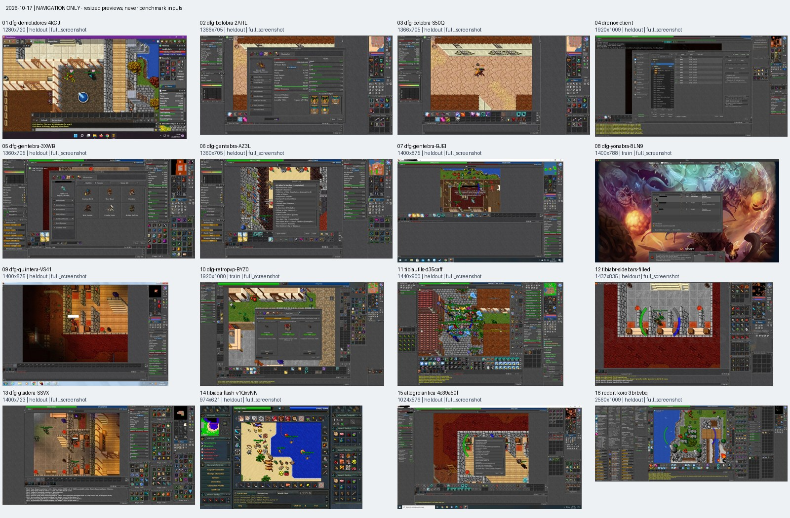
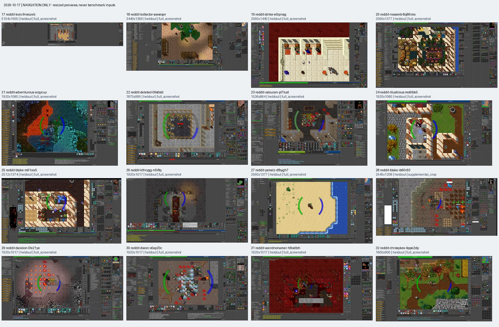

# Real screenshot collection — 2026-10-17

Added **31 new full screenshots plus one partial/uncertain-boundary reference**
to the 19 existing regression images. The 32 downloads are unchanged (55.3 MB),
with source names/marks preserved. Selection, values, visibility, splits and
visual equivalence were frozen in commit `12b52ff` **before reader inference**.
No reader, profile or template was changed.

The batch contains 28 conservative author/listing groups from DFG, Reddit,
DrenoxBot, TibiaUtils, TibiaBR, TibiaQA and Allegro. These are provenance groups,
not proven independent capture sessions. Four images share three existing
lineages: Gentebra RP193 (two additions, heldout), Retro PVP RP535 (train), and
Yonabra EK195 (train). All related new captures retain the same split.

| Evidence role | New images | Scope |
|---|---:|---|
| Primary positive | 22 | Visually equivalent four-resource interfaces; 19 have no known existing-corpus relative |
| Negative safety | 6 | Closed Skills, login, ultrawide empty docks, and shortened Skills with hidden/clipped rows |
| Ambiguity safety | 1 | Skills plus Cyclopedia Character, both showing all four resources |
| Reference only | 3 | Different Demolidores and Flash clients; one uncertain lower boundary |

| Diversity | Observed coverage |
|---|---|
| Extent | 27 complete client bodies, 4 desktops with complete clients, 1 uncertain lower boundary |
| Downloaded size | Full images from 974 to 5104 pixels wide; 576 to 1440 pixels high |
| Resource docks | Far/inner left and right; upper, middle and low docks; differing panel heights and widths |
| Numeric text | One-digit zero, two through five digits, repeated digits, comma grouping, green Capacity; seven/eight-digit ungrouped and fractional values in a different-interface reference |
| Neighboring content | Combat damage, numeric hotkeys, hunt/loot analysers, bestiary counters, inventory grids, Quest Log, mount and boss dialogs |
| Natural hard cases | Clipped label prefixes with complete values; vertically clipped unreadable row; hidden rows; duplicate complete panels; heavy source compression |
| Still missing | Verified resource-value-covering tooltip; simultaneous multiple clients; known native DPI/scaling configurations; live recovery/freshness evidence |

No exact executable version, native capture resolution, DPI or capture timestamp
is inferred from appearance. Equivalence is limited to visible labels/order,
glyphs, alignment, panel styling and surrounding controls for the four inspected
fields. Drenox's resource block passes those visual checks despite its custom
central dialog; the page alone does not identify this image's client build.
Closed/clipped blocks cannot establish glyph equivalence. Different and unresolved
interfaces do not enter primary positive acceptance.

Each new entry records page/direct URLs, retrieval date, original filename,
dimensions, format, SHA-256, extent, publisher-processing uncertainty, source
group, related IDs, complete visible label/value regions and readable text.
No hidden value is borrowed from another image or status bar. The Demolidores
Capacity `104966.56` is readable but cannot fit the existing integer label schema:
its exact text is retained, and its integer truth remains null without rounding.

SHA-256 checks cover all downloaded bytes and decoded RGB in the retained corpus.
No exact duplicate was retained. Perceptual hashes were only duplicate-search
aids; the flagged RP535 pair was visually checked and retained for its materially
different central dialog. Same-source near captures remain related, not counted
as independent evidence. Redundant mount/outfit galleries, monitor photos,
publisher composites, existing duplicates and partial sources were excluded
before inference. The [freeze audit](../tests/fixtures/screenshots/collection-2026-10-17.json)
records rejected large candidates and access limitations, including DFG rate
limiting and unavailable external landing pages.

The freeze's whole-file annotation hashes describe the Windows working copy
(CRLF). Git stores those JSON files with LF; the canonical per-entry hashes are
the portable annotation audit and pass on both platforms. Original image hashes
always describe the exact downloaded bytes and are unaffected by line endings.

Use the [manifest](../tests/fixtures/screenshots/manifest.json) and
[visual reviews](../tests/fixtures/screenshots/visual-review.json) for exact source
links and annotations. The contact sheets below are **resized navigation only**;
they must never become benchmark inputs.




Rebuild metadata and navigation with:

```powershell
python tests/fixtures/screenshots/build_manifest.py
python tools/build_screenshot_navigation.py --batch 2026-10-17
```

The ordinary correctness suite preserves PR #5's existing 19-image regression
contract. Historical synthetic unit diagnostics keep that same fixed scope to
avoid generating unsupported variants of new captures or inflating CI memory.
The new originals are audited without inference by `test_screenshot_collection`
and evaluated separately by the original-only baseline, which preserves and
reports failures rather than requiring new corpus members to pass beforehand.
